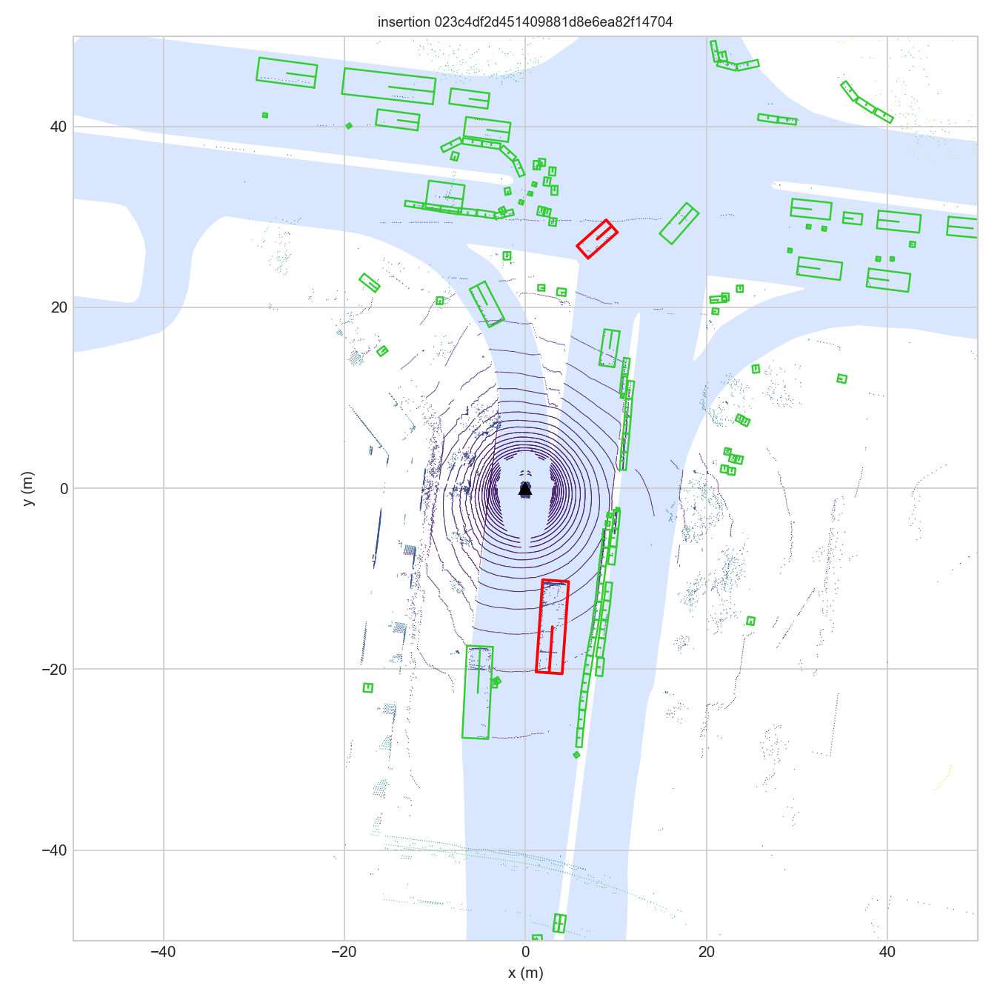
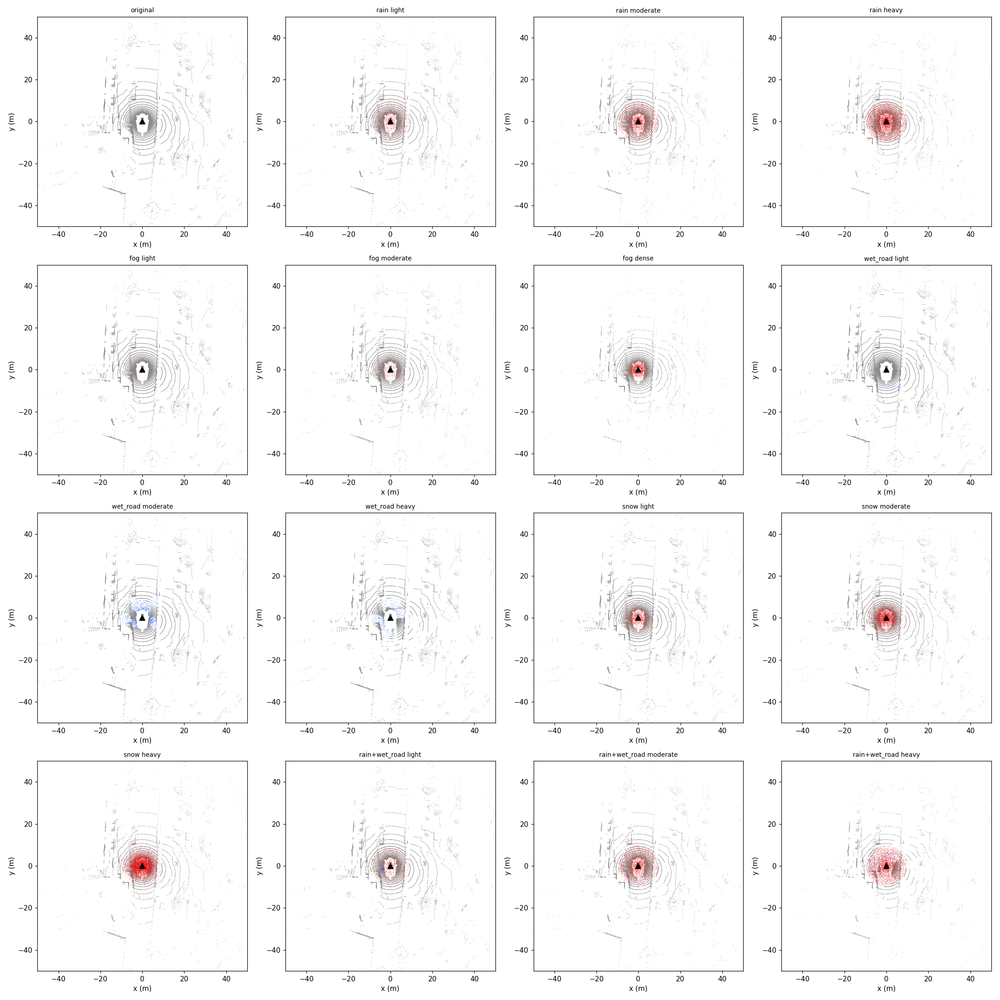

# Hướng dẫn dự án N3-08C — Synthetic Point Cloud Augmentation (nuScenes)

Dự án sinh dữ liệu LiDAR tổng hợp từ nuScenes v1.0-mini:

- **Task A — Object insertion:** cắt point cloud của vật thể thật (template), đặt vào scene khác ở vị trí hợp lệ (trên đường, không va chạm, chạm mặt đất), sinh annotation mới.
- **Task B — Weather simulation:** mô phỏng mưa và sương mù trên point cloud (dropout, noise, suy giảm intensity).
- **Evaluate:** đo tỉ lệ chèn thành công, throughput, thay đổi số điểm và intensity.

> **Thành viên mới:** làm lần lượt mục 2 (cài đặt) → mục 3 (chạy) → so kết quả với mục 4 (kết quả mong đợi). Gặp lỗi thì xem mục 8.

---

## 1. Cấu trúc thư mục

`<repo>` là thư mục bạn clone về (ví dụ `C:\nuscenes-project`). Code tự tính đường dẫn theo vị trí repo, clone vào đâu cũng được.

```
<repo>\
├── datasets\nuscenes\          # dữ liệu nuScenes — KHÔNG có trong git, tự tải (mục 2.2)
├── nuscenes-env\               # virtualenv Python 3.10 — KHÔNG có trong git, tự tạo (mục 2.3)
├── output\                     # kết quả sinh ra khi chạy — KHÔNG có trong git
│   ├── templates\              # template bank (<category>\<ann_token>.npz + bank.json)
│   ├── augmented\              # Task A: <sample_token>.bin + .json
│   ├── weather\                # Task B: original\, <weather>_<level>\ (vd rain_heavy\, snow_light\)
│   ├── vis\                    # ảnh BEV (.png)
│   └── eval_report.json        # kết quả evaluate.py
├── docs\ket_qua_mau\           # kết quả mẫu để đối chiếu (mục 4)
├── extract_objects.py          # script cũ, không dùng nữa (thay bằng task_a/extract_object.py)
├── verify_setup.py, verify_map.py   # script kiểm tra cũ, không dùng nữa (đường dẫn hard-code)
└── n3-08c\                     # CODE CHÍNH
    ├── config.py               # đường dẫn, seed, ngưỡng, tham số ground/weather
    ├── verify_setup.py         # kiểm tra dữ liệu + môi trường
    ├── evaluate.py             # đánh giá Task A + Task B
    ├── requirements.txt        # thư viện, đã ghi cố định phiên bản
    ├── utils\
    │   ├── nuscenes_loader.py  # load nuScenes, point cloud, annotations, pose, calib
    │   ├── transforms.py       # sensor <-> ego <-> global <-> object-local
    │   └── visualization.py    # Open3D 3D + matplotlib BEV
    ├── task_a\
    │   ├── extract_object.py   # crop template, TemplateBank
    │   ├── ground_plane.py     # RANSAC + GroundModel, vùng đặt từ map expansion
    │   ├── placement.py        # sample (x, y, yaw) hợp lệ + collision BEV
    │   ├── merge.py            # đặt template vào scene, tạo annotation
    │   └── run_insertion.py    # pipeline Task A end-to-end
    ├── task_b\
    │   ├── rain.py             # mưa: dropout theo khoảng cách (mốc 10 m) + noise gần sensor + suy giảm intensity + jitter
    │   ├── fog.py              # sương mù: exp-decay dropout + backscatter
    │   ├── wet_road.py         # đường ướt: vũng nước trên mặt đường (mất điểm + giảm intensity)
    │   ├── snow.py             # tuyết: bông tuyết gần sensor + dropout + suy giảm intensity
    │   └── run_weather.py      # pipeline Task B (kể cả kết hợp rain+wet_road)
    └── tests\                  # test trên data thật (conftest.py tạo fixture nusc); test_weather.py không cần dataset
```

---

## 2. Cài đặt (làm một lần)

### 2.1. Yêu cầu

| Thứ | Phiên bản |
|---|---|
| Hệ điều hành | Windows 10/11 (lệnh trong tài liệu viết cho PowerShell) |
| Python | **3.10** (đã test với 3.10.11). Không dùng 3.12+: `open3d==0.20.0` và `numpy==1.26.4` có thể không cài được. |
| Git | bản bất kỳ |
| Ổ đĩa trống | khoảng 8 GB (dataset ~5.5 GB, venv ~0.8 GB, output) |

Kiểm tra: `py -3.10 --version` phải in ra `Python 3.10.x`.

### 2.2. Clone repo

```powershell
git clone <URL repo>
cd <thư mục repo>
```

### 2.3. Tải dữ liệu nuScenes

Dữ liệu không có trong git (giấy phép nuScenes không cho phân phối lại). Mỗi người tự tải:

1. Vào https://www.nuscenes.org/nuscenes#download, đăng ký tài khoản và đăng nhập.
2. Ở mục **Full dataset (v1.0)**, tải **Mini** (`v1.0-mini.tgz`, khoảng 4 GB).
3. Ở mục **Map expansion**, tải **Map expansion pack (v1.3)** (`nuScenes-map-expansion-v1.3.zip`).
4. Giải nén để có cấu trúc sau:

```
<repo>\datasets\nuscenes\
├── v1.0-mini\          # các file .json (sample.json, scene.json, ...)
├── samples\
├── sweeps\
└── maps\
    ├── *.png
    └── expansion\      # 4 file .json từ map expansion (boston-seaport.json, ...)
```

Lưu ý:
- Giải nén `.tgz` bằng 7-Zip hoặc lệnh `tar -xzf v1.0-mini.tgz -C datasets\nuscenes`.
- File zip map expansion có thể chứa sẵn thư mục `expansion\`, `basemap\`, `prediction\`. Chép cả thư mục `expansion\` vào `datasets\nuscenes\maps\`. Không để thành `maps\expansion\expansion\`.

Muốn để dữ liệu ở ổ khác thì đặt biến môi trường trước khi chạy:

```powershell
$env:NUSCENES_DATAROOT = "D:\data\nuscenes"
```

### 2.4. Tạo môi trường Python

```powershell
cd <thư mục repo>
py -3.10 -m venv nuscenes-env
.\nuscenes-env\Scripts\Activate.ps1
python -m pip install --upgrade pip
pip install -r n3-08c\requirements.txt
```

PowerShell báo lỗi "running scripts is disabled" thì chạy một lần, rồi kích hoạt lại:

```powershell
Set-ExecutionPolicy -Scope CurrentUser RemoteSigned
```

Mỗi lần mở terminal mới đều phải kích hoạt lại venv (`.\nuscenes-env\Scripts\Activate.ps1`). Dòng lệnh có tiền tố `(nuscenes-env)` là đã kích hoạt.

### 2.5. Kiểm tra setup

```powershell
cd n3-08c
python verify_setup.py --no-vis
```

Kết quả đúng: các dòng `[OK]`, `Scenes: 10  Samples: 404`, dòng cuối `verify_setup: PASS`.
Bỏ `--no-vis` để mở thêm cửa sổ Open3D xem point cloud.

> **Từ đây trở đi, mọi lệnh chạy trong thư mục `n3-08c\`, với venv đã kích hoạt.**

---

## 3. Quy trình chạy

Thứ tự: setup → build template bank → Task A → Task B → evaluate.

Chạy nhanh toàn bộ (khoảng vài phút, chủ yếu ở bước build):

```powershell
python task_a/extract_object.py --build
python task_a/run_insertion.py
python task_b/run_weather.py --all-levels
python evaluate.py --run-insertion 5
```

Sau đó so kết quả với mục 4. Chi tiết từng bước ở dưới.

### Bước 1 — Build template bank

```powershell
python task_a/extract_object.py --build    # trích template toàn dataset -> output\templates\
python task_a/extract_object.py --stats    # thống kê bank đã build
python task_a/extract_object.py            # demo: object nhiều điểm nhất của sample[0]
python task_a/extract_object.py --ann <ann_token> --show   # xem 1 template bằng Open3D
```

Tuỳ chọn: `--categories vehicle human.pedestrian` (lọc theo tiền tố category), `--min-points 20`.

Template là mảng `(M, 5)` `[x, y, z, intensity, ring]` ở object-local frame: gốc = tâm box, trục x = hướng đầu object, z hướng lên, đáy box ở `z = -h/2`.

### Bước 2 — Task A: chèn object

```powershell
python task_a/run_insertion.py                                     # demo: sample[0] -> sample[10]
python task_a/run_insertion.py --source-sample <tok> --target <tok> --num-objects 3 --vis
python task_a/run_insertion.py --source-ann <ann_token> --target <sample_token>
```

| Tham số | Ý nghĩa | Mặc định |
|---|---|---|
| `--source-sample` | sample lấy object | `sample[0]` |
| `--source-ann` | danh sách annotation token cụ thể | — |
| `--target` | sample token đích | `sample[10]` |
| `--num-objects` | số object chèn | 3 |
| `--n-attempts` | số lần thử vị trí mỗi object | 100 |
| `--seed` | seed RNG | 42 |
| `--vis` | mở Open3D sau khi chèn | tắt |

Output:
- `output\augmented\<target>.bin` — point cloud `(N+M, 5)` float32, sensor frame, cùng format nuScenes.
- `output\augmented\<target>.json` — annotation mới (sensor + global frame), `n_requested`, `n_inserted`, `elapsed_s`.
- `output\vis\insertion_<target>.png` — ảnh BEV.

Pipeline bên trong (`run_insertion`):
1. `GroundModel.from_points` — ước lượng mặt đất (RANSAC + median z cục bộ).
2. `get_map_area` — vùng hợp lệ theo category (`PLACEMENT_LAYERS` trong config: xe → `drivable_area`, người → `walkway`, `ped_crossing`).
3. `sample_valid_position` — random (x, y, yaw) trong vùng, khoảng cách 3–70 m, không chồng box BEV.
4. `insert_object` — transform template tới vị trí, đáy chạm đất, concat vào scene.
5. `create_annotation` — sinh annotation mới.

### Bước 3 — Task B: mô phỏng thời tiết

```powershell
python task_b/run_weather.py                                    # sample[0], rain moderate
python task_b/run_weather.py --weather fog --level dense
python task_b/run_weather.py --weather snow --level heavy
python task_b/run_weather.py --weather wet_road --level moderate
python task_b/run_weather.py --weather rain+wet_road --level heavy    # đường ướt trước, rồi mưa
python task_b/run_weather.py --all-levels                       # mọi weather x level + ảnh so sánh
python task_b/run_weather.py --input ..\output\augmented\<tok>.bin --weather rain --level heavy
```

Level:
- `rain`: `light` / `moderate` / `heavy` (dropout 0.1/0.2/0.3, noise 3/7/12 %).
- `fog`: `light` / `moderate` / `dense` (visibility 200/50/20 m).
- `wet_road`: `light` / `moderate` / `heavy` (5/15/30 vũng, bán kính tối đa 2/4/6 m, mất 60/85/95 % điểm mặt đường trong vũng).
- `snow`: `light` / `moderate` / `heavy` (5/12/25 % beam trúng bông tuyết, mất 10/20/35 % điểm ở 30 m). Tham số tự chọn, chưa hiệu chỉnh với dữ liệu tuyết thật.
- `rain+wet_road`: `light` / `moderate` / `heavy`, cùng level cho cả hai bước.

`--input` nhận output của Task A, dùng để kết hợp chèn object + thời tiết.

Output (`output\weather\`):
- `original\<name>.bin` — bản gốc.
- `<weather>_<level>\<name>.bin` — point cloud sau mô phỏng.
- `<weather>_<level>\<name>_labels.npy` — `0` = điểm gốc, `1` = noise (giọt mưa / backscatter / bông tuyết), `2` = điểm gốc còn lại trong vũng nước. Hằng số: `config.LABEL_*`.
- `output\vis\weather_<name>.png` — ảnh BEV so sánh.

### Bước 4 — Đánh giá

```powershell
python evaluate.py                       # đánh giá kết quả có sẵn trong output\
python evaluate.py --run-insertion 20    # chạy Task A trên 20 sample rồi đánh giá
```

Kết quả in ra màn hình và lưu `output\eval_report.json`:
- `insertion`: `valid_rate` (inserted / requested), `total_objects`, `scenes_per_hour`, `per_category`.
- `weather/<weather>_<level>`: `point_count_change` (mean_ratio, mean_diff), `intensity_stats` trước/sau.

---

## 4. Kết quả mong đợi

Số liệu dưới đây chạy trên nuScenes v1.0-mini, `SEED = 42`. File gốc và ảnh nằm trong [docs/ket_qua_mau/](docs/ket_qua_mau/).
Chạy cùng dữ liệu, cùng seed thì các con số (trừ thời gian chạy) phải giống hoặc rất gần.

### 4.1. Template bank (`extract_object.py --build`)

Tổng **4111 template**, 14 category:

| Category | Số template | Category | Số template |
|---|---|---|---|
| vehicle.car | 2117 | vehicle.construction | 110 |
| human.pedestrian.adult | 582 | vehicle.motorcycle | 90 |
| movable_object.barrier | 579 | vehicle.trailer | 47 |
| vehicle.truck | 302 | movable_object.trafficcone | 37 |
| vehicle.bus.rigid | 167 | vehicle.bus.bendy | 31 |
| human.pedestrian.personal_mobility | 20 | human.pedestrian.construction_worker | 17 |
| vehicle.bicycle | 7 | movable_object.pushable_pullable | 5 |

### 4.2. Task A — chèn object

Mẫu: [docs/ket_qua_mau/023c4df2d451409881d8e6ea82f14704.json](docs/ket_qua_mau/023c4df2d451409881d8e6ea82f14704.json) (target `023c4df2...`, chèn 2/2 object, khoảng 2.4 s).

Kết quả đánh giá insertion (6 scene):

| Chỉ số | Giá trị |
|---|---|
| `valid_rate` | 1.0 (mọi object yêu cầu đều chèn được) |
| `total_objects` | 10 (vehicle.truck 6, vehicle.car 4) |
| `scenes_per_hour` | khoảng 1580 (phụ thuộc máy) |

Ảnh BEV: object chèn vào phải nằm trên vùng đường, không chồng lên box có sẵn, chân chạm mặt đất.



### 4.3. Task B — thời tiết

Sample `ca9a282c...` (sample[0]), point cloud gốc khoảng 34 700 điểm, intensity trung bình 19.85.

| Weather / level | Tỉ lệ điểm còn lại | Số điểm thay đổi | Intensity TB sau | Tỉ lệ noise | Tỉ lệ điểm vũng nước |
|---|---|---|---|---|---|
| rain light | 0.925 | -2 614 | 17.70 | 3.2% | 0.0% |
| rain moderate | 0.871 | -4 462 | 16.12 | 8.0% | 0.0% |
| rain heavy | 0.846 | -5 344 | 14.11 | 14.2% | 0.0% |
| fog light | 0.949 | -1 783 | 18.81 | 0.6% | 0.0% |
| fog moderate | 0.833 | -5 784 | 16.91 | 2.3% | 0.0% |
| fog dense | 0.685 | -10 919 | 14.95 | 7.3% | 0.0% |
| wet_road light | 0.994 | -199 | 19.83 | 0.0% | 0.4% |
| wet_road moderate | 0.831 | -5 853 | 19.96 | 0.0% | 3.5% |
| wet_road heavy | 0.753 | -8 565 | 21.20 | 0.0% | 1.7% |
| snow light | 0.962 | -1 307 | 17.45 | 5.3% | 0.0% |
| snow moderate | 0.931 | -2 381 | 15.57 | 12.5% | 0.0% |
| snow heavy | 0.897 | -3 584 | 12.97 | 28.0% | 0.0% |
| rain+wet_road light | 0.920 | -2 775 | 17.65 | 3.2% | 0.5% |
| rain+wet_road moderate | 0.856 | -4 978 | 16.17 | 8.0% | 0.4% |
| rain+wet_road heavy | 0.621 | -13 146 | 15.21 | 14.4% | 1.7% |

Hai cột cuối là `label_ratio` trong `eval_report.json`: phần điểm đầu ra mang nhãn noise / nhãn vũng nước.

Cách đọc:
- `rain`, `fog`, `snow`, `rain+wet_road`: level càng nặng thì càng mất nhiều điểm và intensity càng giảm. Kết quả sai nếu không theo xu hướng này.
- `wet_road`: chỉ mất điểm mặt đường trong vũng; intensity TB toàn cảnh tăng nhẹ vì điểm mặt đường có intensity thấp. Kết quả phụ thuộc mạnh vào vị trí vũng (seed): một vũng lớn rơi sát xe làm mất rất nhiều điểm, như ở level moderate và heavy trong bảng này.



Ảnh khác trong `docs/ket_qua_mau/`: `bev_*` (point cloud gốc), `ground_*` (mặt đất ước lượng), `drivable_*` (vùng được phép đặt object).

---

## 5. Chạy từng module (demo)

Mỗi module có demo riêng, dùng để kiểm tra nhanh khi sửa code:

```powershell
python utils/nuscenes_loader.py
python utils/transforms.py
python utils/visualization.py     # lưu ảnh BEV vào output\vis
python task_a/ground_plane.py     # ảnh BEV vùng đặt object
python task_a/placement.py
python task_a/merge.py
python task_b/rain.py
python task_b/fog.py
python task_b/wet_road.py
python task_b/snow.py
```

---

## 6. Test

Test chạy trên data thật (cần dataset + map expansion), riêng `test_weather.py` dùng point cloud tổng hợp nên chạy được khi chưa có dataset. `pytest` đã có trong `requirements.txt`.

```powershell
pytest tests/
python tests/test_utils.py          # chạy riêng từng file, không cần pytest
python tests/test_ground_plane.py
python tests/test_extract_object.py
python tests/test_weather.py        # không cần dataset
```

| File | Kiểm tra |
|---|---|
| `test_utils.py` | loader, transforms khớp nuScenes devkit; vẽ BEV |
| `test_ground_plane.py` | RANSAC trên dữ liệu tổng hợp, GroundModel theo dốc, sai số với đáy box thật, map area |
| `test_extract_object.py` | template nằm trong box, roundtrip local frame, ground margin, save/load, build bank |
| `test_weather.py` | rain, wet_road, snow, run_weather trên point cloud tổng hợp: format đầu ra, nhãn, cùng seed cùng kết quả, level nặng hơn mất nhiều điểm hơn, điểm ngoài vũng nước giữ nguyên |

Trước khi push code, chạy `pytest tests/` và đảm bảo không có test fail.

---

## 7. Cấu hình (`n3-08c\config.py`)

| Nhóm | Biến | Ghi chú |
|---|---|---|
| Đường dẫn | `PROJECT_ROOT` | tự tính = thư mục cha của `n3-08c\` |
| Dataset | `DATAROOT`, `VERSION`, `LIDAR_CHANNEL` | `DATAROOT` mặc định `<repo>\datasets\nuscenes`, override bằng `NUSCENES_DATAROOT` |
| Output | `OUTPUT_DIR`, `TEMPLATE_DIR`, `AUGMENTED_DIR`, `WEATHER_DIR`, `VIS_DIR` | `OUTPUT_DIR` mặc định `<repo>\output`, override bằng `N308C_OUTPUT_DIR` |
| Chung | `SEED = 42` | đổi seed thì kết quả mục 4 sẽ khác |
| Task A | `MIN_DISTANCE`, `MAX_DISTANCE` | khoảng cách đặt object (m) |
| | `COLLISION_IOU_THRESH` | BEV IoU > ngưỡng = va chạm |
| | `MIN_TEMPLATE_POINTS`, `TEMPLATE_GROUND_MARGIN`, `TEMPLATE_CATEGORIES` | lọc template |
| | `GROUND` | tham số RANSAC + GroundModel |
| | `PLACEMENT_LAYERS`, `DEFAULT_LAYERS` | map layer hợp lệ theo category |
| Task B | `RAIN_LEVELS`, `FOG_VISIBILITY`, `WET_ROAD_LEVELS`, `SNOW_LEVELS` | thêm level mới ở đây |
| | `WET_ROAD_GROUND_TOL` | điểm cao hơn mặt đất cục bộ quá ngưỡng này (m) không tính là mặt đường |
| | `LABEL_ORIGINAL`, `LABEL_NOISE`, `LABEL_PUDDLE`, `LABEL_NAMES` | mã nhãn trong `_labels.npy`, dùng chung cho mọi weather |

### Quy ước dữ liệu

- Point cloud: `(N, 5)` float32 `[x, y, z, intensity, ring]`, file `.bin` đọc bằng `np.fromfile(path, np.float32).reshape(-1, 5)` (`utils.nuscenes_loader.load_bin`).
- Mọi xử lý Task A/B ở **LIDAR_TOP sensor frame** (sensor cao khoảng 1.84 m, mặt đất z ≈ -1.8).
- Annotation dict: `translation` (3,), `size` = `[w, l, h]`, `rotation` = quaternion `[w, x, y, z]` (theo nuScenes).
- Khi transform chỉ 3 cột xyz thay đổi, intensity và ring giữ nguyên.

---

## 8. Lỗi thường gặp

| Lỗi | Cách xử lý |
|---|---|
| `Không thấy v1.0-mini/sample.json trong ...` | Dữ liệu chưa đúng chỗ. Kiểm tra cấu trúc mục 2.3, hoặc đặt `NUSCENES_DATAROOT`. |
| `[MISSING] ...\maps\expansion` | Chưa có map expansion, hoặc bị lồng `maps\expansion\expansion\`. Xem mục 2.3. |
| `running scripts is disabled on this system` | `Set-ExecutionPolicy -Scope CurrentUser RemoteSigned`. |
| `pip install` lỗi ở `open3d` hoặc `numpy` | Sai phiên bản Python. Xoá `nuscenes-env\`, tạo lại bằng `py -3.10 -m venv nuscenes-env`. |
| `ModuleNotFoundError: No module named 'nuscenes'` (hoặc thư viện khác) | Chưa kích hoạt venv. Chạy `.\nuscenes-env\Scripts\Activate.ps1`. |
| `ModuleNotFoundError: config` / `utils` | Chạy lệnh từ thư mục `n3-08c\`. |
| Cửa sổ Open3D không mở / treo | Dùng `--no-vis` hoặc bỏ `--vis`; ảnh BEV vẫn lưu trong `output\vis`. |
| `n_inserted < n_requested` | Không tìm được vị trí hợp lệ. Tăng `--n-attempts` hoặc chọn target có vùng đường rộng. |
---

## 9. Làm việc nhóm với Git

- Không commit `datasets\`, `nuscenes-env\`, `output\` (đã có trong `.gitignore`). GitHub chặn file trên 100 MB.
- Cập nhật code mới nhất trước khi làm: `git pull`.
- Làm trên nhánh riêng, ví dụ `git checkout -b task-b-snow`, rồi tạo Pull Request.
- Thêm thư viện mới thì ghi kèm phiên bản vào `n3-08c\requirements.txt`.
- Thay đổi làm kết quả mục 4 khác đi thì cập nhật lại `docs\ket_qua_mau\` và bảng ở mục 4.

---

## 10. Việc còn dở (TODO trong code)

- `merge.py`: xoá điểm target nằm trong box mới; xử lý occlusion (range image).
- `run_insertion.py`: chọn template theo category / khoảng cách phù hợp target.
- `rain.py`: hiệu chỉnh `ATTENUATION` và `DROPOUT_REF_RANGE` theo dữ liệu mưa thật; gắn noise theo đúng beam của sensor (ring/azimuth có thật) thay vì đều trong cầu.
- `wet_road.py`: vũng nước theo chỗ trũng của mặt đường thay vì ellipse ngẫu nhiên; điểm ảo phản xạ dưới mặt đường.
- `snow.py`: hiệu chỉnh `SNOW_LEVELS` và phân bố bông tuyết theo dữ liệu thật.
- `fog.py`: hiệu chỉnh `BACKSCATTER_REF` theo dữ liệu thật.
- `run_weather.py`: kết hợp với sương mù (`simulate_fog` chưa nhận nhãn đầu vào).
- `evaluate.py`: lý do reject (off_road / collision), so sánh phân bố points/box, thống kê theo dải khoảng cách.
